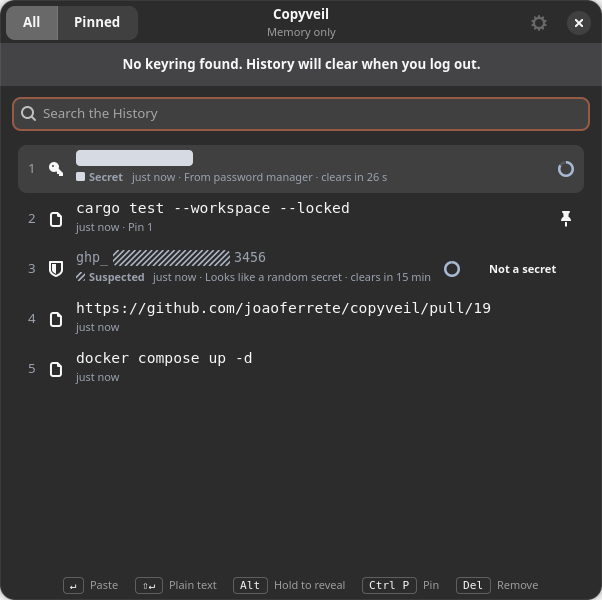

<p align="center">
  
</p>

<h1 align="center">Copyveil</h1>

<p align="center"><b>Remembers what you copy. Forgets your secrets.</b></p>

<p align="center">
  <a href="https://github.com/joaoferrete/copyveil/actions/workflows/ci.yml"></a>
  <a href="https://scorecard.dev/viewer/?uri=github.com/joaoferrete/copyveil"></a>
  <a href="LICENSE"></a>
</p>

Copyveil is a clipboard history manager for Linux, built for people who copy API keys, tokens and passwords all day. It speaks English and Brazilian Portuguese ([help translate](docs/translating.md)). Press a shortcut, find what you copied, paste it again. Secrets are masked, kept in memory only, and erased after a short time. Everything else is encrypted on disk.

> **Status: 0.1, GNOME only.** Capture, detection, Masks, Expiry, Pins, the encrypted store, the popup, settings and onboarding all work on GNOME Shell 50. KDE Plasma, COSMIC and wlroots arrive in 0.2. See the [roadmap](docs/roadmap.md).

<p align="center">
  
</p>

## How it treats what you copy

Every Item in the History has a **Sensitivity**:

| | How Copyveil knows | Stored | Shown | Erased |
|---|---|---|---|---|
| **Secret** | A password manager marked it (`x-kde-passwordManagerHint`) | Memory only | Solid mask, fixed width | After 30 s, and the clipboard is cleared |
| **Suspected** | It looks like a token or key (GitHub, AWS, AI providers, JWT, PEM, high entropy) | Memory only | Hatched mask, ends visible | After 15 min |
| **Plain** | Nothing suggests a secret | Encrypted on disk | As is | By history limit |

You can change an Item's Sensitivity by hand. Search never looks inside Secret or Suspected Items, so nobody can recover one by typing guesses. The full threat model, including what Copyveil cannot protect against, is in [SECURITY.md](SECURITY.md).

## Desktop support

| Desktop | Capture | Paste with <kbd>Enter</kbd> | Status |
|---|---|---|---|
| GNOME (Wayland) | Copyveil Shell extension | Yes | v0.1 |
| KDE Plasma, COSMIC, wlroots (Sway, Hyprland) | `ext-data-control-v1` | Copies, you press <kbd>Ctrl</kbd>+<kbd>V</kbd> | v0.2 |

GNOME doesn't let regular apps watch the clipboard, so a small Shell extension passes each copy to Copyveil and stores nothing itself. See [ADR 0001](docs/adr/0001-desktop-agnostic-core-with-pluggable-capture-sources.md).

## Install

One command checks, installs and sets up everything, on Ubuntu 24.04+, Debian 13+, Fedora and Arch Linux:

```sh
git clone https://github.com/joaoferrete/copyveil.git
cd copyveil
./install.sh --install-deps
```

`install.sh` does it in this order:

1. Checks every dependency against the version Copyveil needs.
2. Installs the missing system packages with your distribution's package manager. It asks for sudo, and shows the command first.
3. Builds Copyveil.
4. Installs it into `~/.local`, without sudo.
5. Starts the daemon with your session.
6. Installs and turns on the GNOME Shell extension.

Rust is the one thing it won't install for you: it points you to [rustup](https://rustup.rs), which then installs the toolchain pinned in `rust-toolchain.toml` on its own.

Then log out and back in, and open Copyveil from your apps. A short onboarding checks that everything works on your desktop: its last step copies a made-up token and shows it masked. After that, <kbd>Super</kbd>+<kbd>Shift</kbd>+<kbd>V</kbd> opens the History (onboarding offers <kbd>Super</kbd>+<kbd>V</kbd>, which GNOME uses for notifications by default), and Settings are one click away in the popup, or <kbd>Ctrl</kbd>+<kbd>,</kbd>.

To keep the History across logins you need a Secret Service keyring: GNOME Keyring (GNOME's default) or KWallet. Without one, Copyveil keeps the History in memory only and says so.

**Updating**: `git pull`, then `./install.sh` again. It rebuilds, reinstalls and restarts the daemon. Secret and Suspected Items live in memory only, so a restart clears them. GNOME Shell loads the new extension at your next login.

| Option | What it does |
|---|---|
| `--check` | Only check the dependencies |
| `--install-deps` | Install missing system packages first (asks for sudo) |
| `--system` | Install for every user, in `/usr/local` (asks for sudo) |
| `--uninstall` | Remove Copyveil, keeping your History and settings |
| `--uninstall --purge` | Also erase your History, settings and onboarding state |
| `--no-session` | Skip systemd and the extension (for packaging and tests) |
| `--yes` | Don't ask before acting |

<details>
<summary>Installing by hand</summary>

You need Rust through [rustup](https://rustup.rs) (it installs the version pinned in `rust-toolchain.toml` on its own), plus Meson ≥ 1.1, Ninja, `pkg-config`, gettext and the GTK 4 (≥ 4.14) and libadwaita (≥ 1.5) development files. SQLite is built in.

| Distribution | Command |
|---|---|
| Ubuntu 24.04+, Debian 13+ | `sudo apt install build-essential pkg-config meson ninja-build gettext libgtk-4-dev libadwaita-1-dev` |
| Fedora | `sudo dnf install gcc pkgconf-pkg-config meson ninja-build gettext gtk4-devel libadwaita-devel` |
| Arch Linux | `sudo pacman -S --needed base-devel meson ninja gettext gtk4 libadwaita` |

```sh
meson setup _build --prefix=/usr/local
meson compile -C _build
sudo meson install -C _build
systemctl --user enable --now copyveil-daemon.service
tools/pack-extension.sh
gnome-extensions install --force _build/copyveil@joaoferrete.github.io.shell-extension.zip
```

For an install in `~/.local`, add `-Dsystemd_user_unit_dir=$HOME/.local/share/systemd/user` to `meson setup`, since the systemd user manager doesn't look in `~/.local/lib`.

</details>

Flatpak (Flathub) is planned for v0.2.

## Contributing

Contributions are welcome. [CONTRIBUTING.md](CONTRIBUTING.md) covers setup, commit and PR conventions, and the testing bar. Documentation lives in [`docs/`](docs/README.md), and the project's vocabulary is defined in [GLOSSARY.md](GLOSSARY.md).

## License

[GPL-3.0-or-later](LICENSE).
