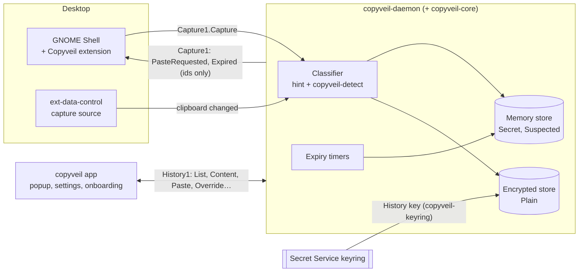

# Architecture

Copyveil has three kinds of process: a **daemon** that owns all state, **capture sources** that report clipboard changes to it, and the **app** that shows the History. Only the daemon ever holds History. Why it's split this way: [ADR 0001](adr/0001-desktop-agnostic-core-with-pluggable-capture-sources.md). How the crates are layered, and the rules that keep them so: [engineering guide](engineering.md#architecture).

## Crates and directories

| Path | What it is |
|---|---|
| `crates/copyveil-core` | Library. History, Sensitivity rules, Expiry, the encrypted store. Desktop-agnostic and free of D-Bus. |
| `crates/copyveil-dbus` | The D-Bus contract: bus names, the Item summary and client proxies. Shared by the daemon and the app, with no logic and no Item content. |
| `crates/copyveil-daemon` | `copyveil-daemon` binary. Holds the History and serves it over D-Bus ([API](dbus.md)), runs Expiry, and opens the store with the key from `copyveil-keyring`. |
| `crates/copyveil-keyring` | Reads and creates the History key in the Secret Service keyring with `oo7`. Thin on purpose: it can only be tested against a running keyring. |
| `crates/copyveil-detect` | Pure library. Detectors that flag content as Suspected. No I/O, so it's easy to test, fuzz and reuse. |
| `crates/copyveil-app` | `copyveil` binary. GTK4/libadwaita UI: popup, settings, onboarding. Talks to the core over D-Bus only. |
| `crates/copyveil-capture-datacontrol` | Capture source for KDE, COSMIC and wlroots compositors (v0.2). |
| `gnome-extension/` | GNOME capture source (GJS): forwards clipboard changes, draws the panel icon, binds the global shortcut and injects <kbd>Ctrl</kbd>+<kbd>V</kbd>. |
| `design/tokens.json` | Design tokens, the single source for colours, spacing, radii and motion ([ADR 0003](adr/0003-design-tokens-as-single-source-and-sensitivity-by-shape.md)). |
| `data/` | Desktop file, metainfo, icons and generated stylesheets. |
| `tools/` | Repository tooling (token generator and contrast check). |

## How an Item flows

1. The user copies something. The capture source reads the content and the MIME types on offer, and sends both to the core.
2. The core classifies the Item. If the source flagged it with `x-kde-passwordManagerHint: secret`, it's a Secret. Otherwise `copyveil-detect` decides between Suspected and Plain. The user can change this later with an Override.
3. Secret and Suspected Items go to the memory store with an Expiry timer. Plain Items are sealed one by one and written to the store on disk ([ADR 0005](adr/0005-plain-store-is-sqlite-with-per-item-xchacha20-poly1305.md)).
4. The app asks the daemon for the History with `History1.List`. Masked Items arrive without their content. Content reaches the app only through `History1.Content`, for a Reveal, and only for that one Item.
5. On paste, the app calls `History1.Paste` and the daemon emits `Capture1.PasteRequested` with the Item's id. The capture source fetches the content, puts it on the clipboard and pastes. On GNOME, the extension injects <kbd>Ctrl</kbd>+<kbd>V</kbd>.
6. When a Secret or Suspected Item reaches its Expiry, the daemon erases it and emits `Capture1.Expired` with its id. A capture source that last put that Item on the clipboard clears the clipboard. Signals carry ids only ([D-Bus API](dbus.md)).

## Lifecycle

- **Native install**: a systemd user unit starts the daemon at login. The onboarding enables it.
- **Flatpak**: the app asks the Background portal for autostart.
- **Both**: the daemon is also D-Bus activatable, so a capture source can start it.
- When the daemon is unreachable, capture sources drop the change. They never buffer content.
