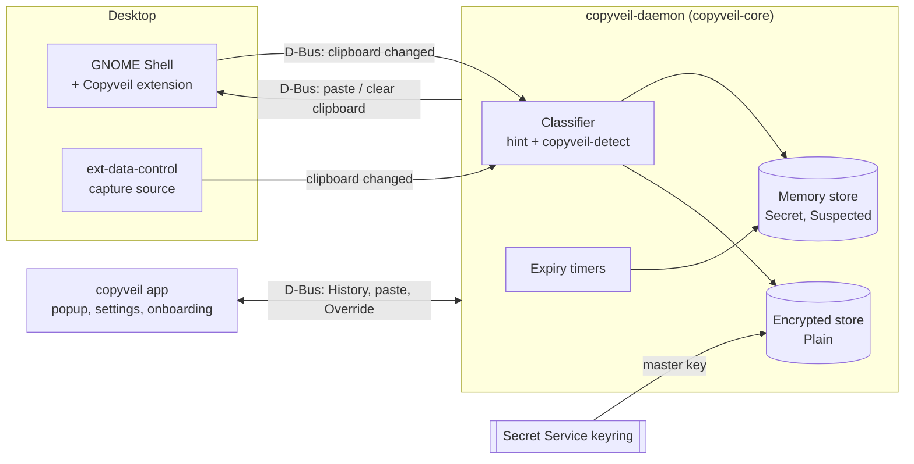

# Architecture

Copyveil has three kinds of process: a **core daemon** that owns all state, **capture sources** that report clipboard changes to it, and the **app** that shows the History. Only the core ever holds History. Why it's split this way: [ADR 0001](adr/0001-desktop-agnostic-core-with-pluggable-capture-sources.md).

## Crates and directories

| Path | What it is |
|---|---|
| `crates/copyveil-core` | Library + `copyveil-daemon` binary. History, Sensitivity rules, Expiry, encryption at rest, D-Bus service. |
| `crates/copyveil-detect` | Pure library. Detectors that flag content as Suspected. No I/O, so it's easy to test, fuzz and reuse. |
| `crates/copyveil-app` | `copyveil` binary. GTK4/libadwaita UI: popup, settings, onboarding. Talks to the core over D-Bus only. |
| `crates/copyveil-capture-datacontrol` | Capture source for KDE, COSMIC and wlroots compositors (v0.2). |
| `gnome-extension/` | GNOME capture source (GJS): forwards clipboard changes, draws the panel icon, binds the global shortcut and injects <kbd>Ctrl</kbd>+<kbd>V</kbd>. |
| `design/tokens.json` | Design tokens, the single source for colours, spacing, radii and motion ([ADR 0003](adr/0003-design-tokens-as-single-source-and-sensitivity-by-shape.md)). |
| `data/` | Desktop file, metainfo, icons and generated stylesheets. |
| `tools/` | Repository tooling (token generator and contrast check). |

## How an Item flows

1. The user copies something. The capture source reads the content and the MIME types on offer, and sends both to the core.
2. The core classifies the Item. If the source flagged it with `x-kde-passwordManagerHint: secret`, it's a Secret. Otherwise `copyveil-detect` decides between Suspected and Plain. The user can change this later with an Override.
3. Secret and Suspected Items go to the memory store with an Expiry timer. Plain Items are encrypted and written to the store on disk.
4. The app asks the core for the History over D-Bus. Masked Items arrive without their content; content reaches the app only for a Reveal or a paste, and only for that one Item.
5. On paste, the core puts the content on the clipboard and asks the capture source to paste. On GNOME, the extension injects <kbd>Ctrl</kbd>+<kbd>V</kbd>. After a Secret is pasted, the core clears it from the clipboard when its timer runs out.

## Lifecycle

- **Native install**: a systemd user unit starts the daemon at login. The onboarding enables it.
- **Flatpak**: the app asks the Background portal for autostart.
- **Both**: the daemon is also D-Bus activatable, so a capture source can start it.
- When the daemon is unreachable, capture sources drop the change. They never buffer content.
