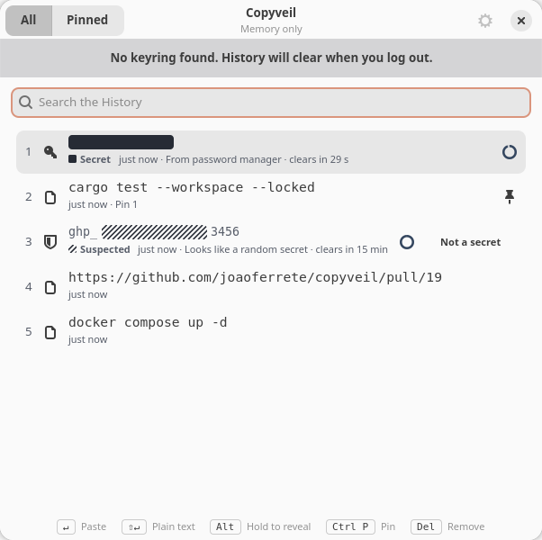
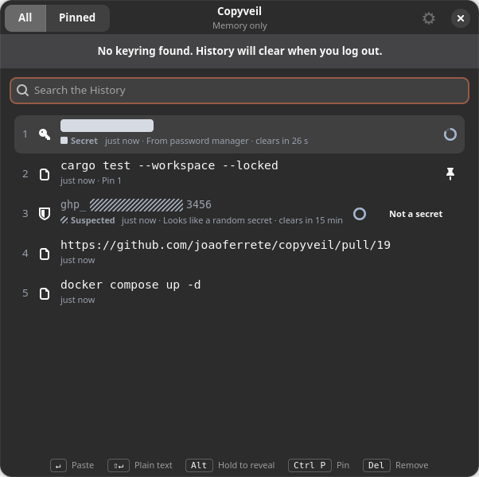
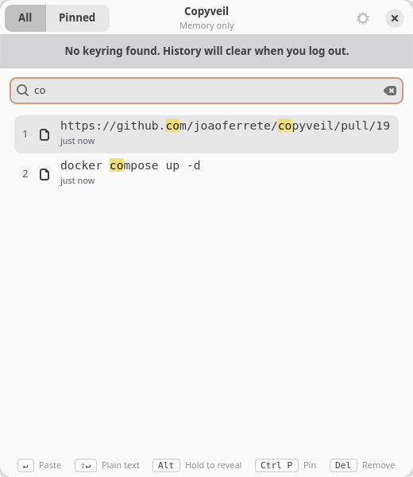
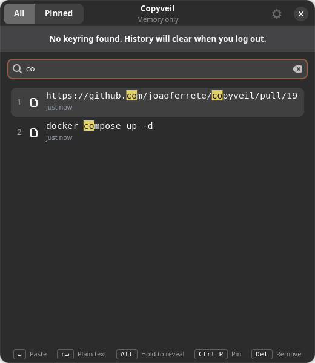
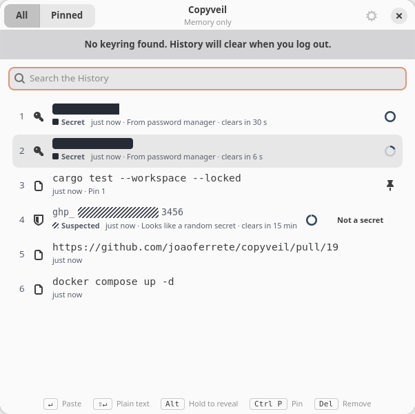
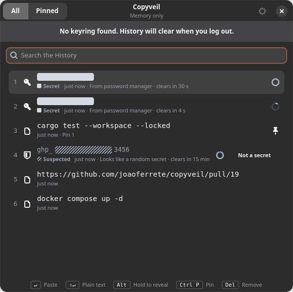
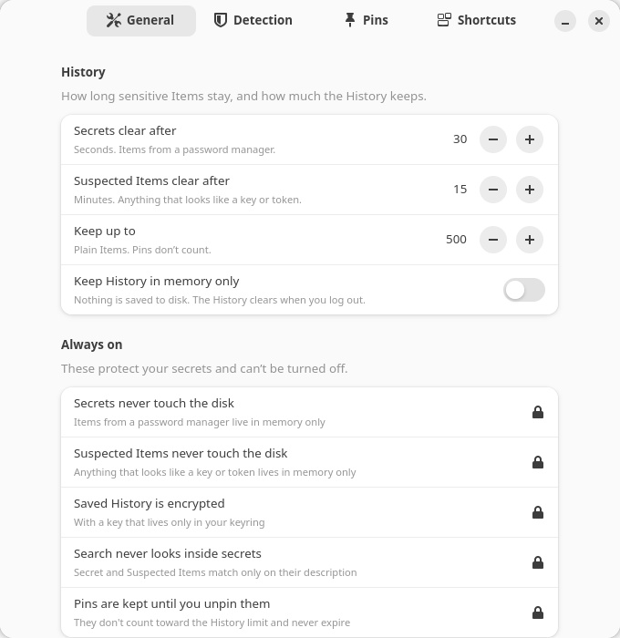
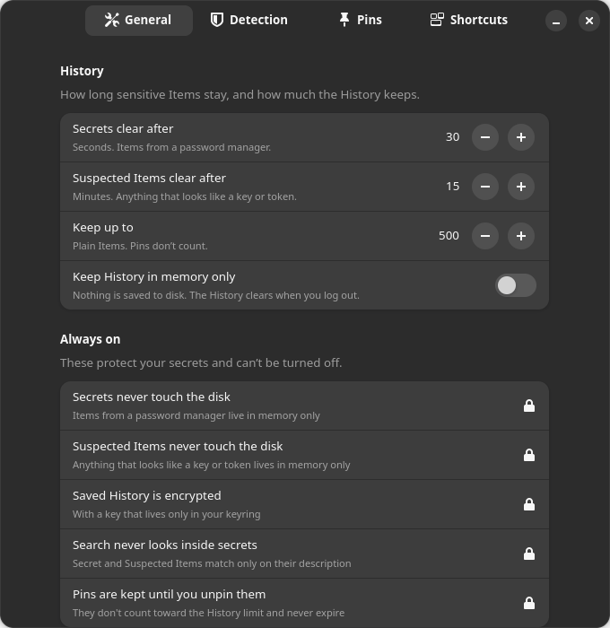
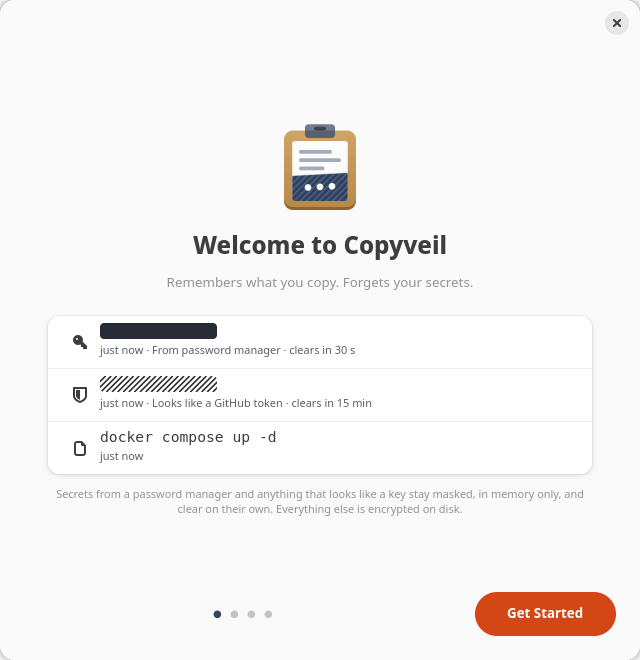
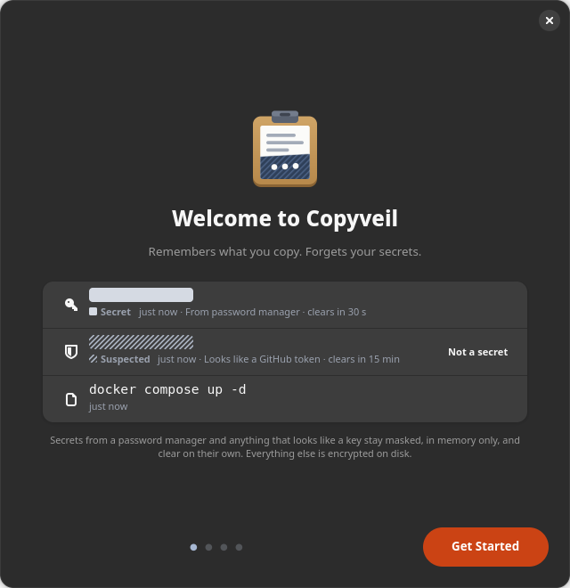

# Design

Copyveil should be pleasant to use, not just safe. The interface is part of the product: the way a secret is hidden is how the user learns it's safe.

## Principles

1. **Native first.** The app chrome is plain libadwaita and follows the user's accent colour. The brand appears only where it carries meaning: the icon, Sensitivity, onboarding.
2. **Shape carries meaning.** A Mask's shape tells the user what kind of Item it is, so colour is never the only cue ([ADR 0003](../adr/0003-design-tokens-as-single-source-and-sensitivity-by-shape.md)).
3. **Keyboard first.** Everything in the popup works without a mouse. Every action has a visible shortcut hint.
4. **Motion explains.** Animation appears only in the four signature moments below. Everything else is still.
5. **Nothing leaks through the UI.** Not the value, not its length (Secret Masks are fixed width), not through search, not to a screen reader.

## Concept: the security envelope

Bank envelopes carry a printed blue tint on the inside, so nobody can read the letter against the light. It's a veil made of paper. Copyveil borrows that object and the things around it: the kraft hardboard of a clipboard, the white sheet, the slate tint.

| Token | Light | Dark | Use |
|---|---|---|---|
| Ink | `#191C22` | `#E7E9ED` | Text |
| Sheet | `#FFFFFF` | `#181B21` | Content surface |
| Slate | `#34465F` | `#A7B8D3` | Brand: ExpiryRing, onboarding |
| Security tint | pattern | pattern | Suspected Mask, onboarding art |
| Kraft | `#C49A5C` | `#C9A26A` | App icon only |
| Marker | `#F1DF74` | `#E2D068` | Search match highlight only, in Plain previews |

In dark theme the Secret Mask turns light, like correction tape on carbon paper.

## Tokens

`design/tokens.json` is the only place colours, spacing, radii, Mask geometry and motion are defined. After editing it, run `just tokens-gen` to regenerate `data/ui/style.css` and `data/ui/style-dark.css`, and `crates/copyveil-app/src/tokens.rs` for the few colours drawn outside CSS (the search highlight is a Pango attribute). CI checks that the generated files are current and that every pair listed under `contrast` meets WCAG AA in both themes.

Typography uses the system fonts: Adwaita Sans for UI, Adwaita Mono for Item content.

## Components

Each component is a reusable GTK widget. A component's entry here lists its purpose, states and keyboard behaviour, plus light and dark screenshots once it exists.

| Component | Purpose | Status |
|---|---|---|
| `ItemRow` | One Item in the popup: type glyph, content, meta line, and its number (1–9) for <kbd>Ctrl</kbd>+number paste. Fixed height, so the list doesn't jump on Reveal. | Built (`row.rs`) |
| `MaskedText` | Solid bar (Secret) or security-tint hatch (Suspected), both a fixed width. A Suspected Item of 20 characters or more shows its first and last 4 beside the hatch (`History1.SuspectedEnds`), dimmed and hidden from screen readers. Draws in, peels off and dissolves (see Motion). | Built (`mask.rs`, `row.rs`) |
| `ExpiryRing` | Ring in Slate that empties until the Item's Expiry, measured against the current Expiry setting. | Built (`ring.rs`) |
| `SensitivityBadge` | Shape swatch plus label, in the row's meta line. Plain has no badge. | Built (`mask.rs`) |
| `OverrideButton` | "Not a secret" on a Suspected Item (or <kbd>Ctrl</kbd>+<kbd>N</kbd>): Overrides it to Plain, then a toast offers to stop flagging similar text by turning its detector off. | Built (`row.rs`, `window.rs`) |
| `PinToggle` | Plain Items only. On Secret or Suspected, the shortcut shows a toast explaining why. | Planned |
| `EmptyState` | Names what will appear and how to get there. | Built (in `window.rs`) |
| `SettingsWindow` | libadwaita preferences in their own window: General (expiry, History size, memory-only with a confirmation), Detection (a switch per detector), Pins (reorder Pin slots) and Shortcuts (from the extension's settings). An “Always on” group shows the rules that can't change, with a lock. | Built (`prefs_window.rs`) |
| `OnboardingStep` | One page of the four-step onboarding: Welcome (the three Sensitivities as sample rows), Capture (the extension, and Super+V), Storage (keyring or memory only) and the live test, which can't be skipped the first time. The current step's dot is Slate. | Built (`onboarding_window.rs`) |

### Screenshots

The app as of the latest UI change, generated with `just app-screenshot` from synthetic Items:

| | Light | Dark |
|---|---|---|
| Popup |  |  |
| Search |  |  |
| Veil draw (mid-animation) |  |  |
| Settings |  |  |
| Onboarding |  |  |

Regenerate them in any PR that changes how the app looks.

## Popup keyboard

Typing always goes to the search. Everything else:

| Keys | What it does |
|---|---|
| <kbd>↑</kbd> <kbd>↓</kbd>, <kbd>Page Up</kbd> <kbd>Page Down</kbd> | Move the selection |
| <kbd>↵</kbd> | Paste the selected Item. Rich text keeps its formatting: the app offers HTML and plain text together, and the target app takes what it understands |
| <kbd>⇧</kbd>+<kbd>↵</kbd> | Paste as plain text |
| <kbd>Ctrl</kbd>+<kbd>1…9</kbd> | Paste the row with that number |
| hold <kbd>Alt</kbd> | Reveal the selected masked Item, for at most 5 s |
| <kbd>Ctrl</kbd>+<kbd>P</kbd> | Pin or unpin (Plain Items only) |
| <kbd>Ctrl</kbd>+<kbd>N</kbd> | "Not a secret" on a Suspected Item |
| <kbd>Del</kbd> | Remove (when the search is empty) |
| <kbd>Ctrl</kbd>+<kbd>Tab</kbd> | Switch between All and Pinned |
| <kbd>Ctrl</kbd>+<kbd>,</kbd> | Settings |
| <kbd>Esc</kbd> | Close |

## Motion

| Moment | What happens | Timing |
|---|---|---|
| Veil draw | A sensitive Item arrives; its Mask draws left to right. The value is never visible first. | 280 ms, `cubic-bezier(.2,.7,.2,1)` |
| Hold to reveal | The Mask peels away while held, and drops back on release. At most 5 s. | 170 ms ease-out |
| Expiry | The Mask dissolves, then the row collapses. No tombstone. | 300 ms + 460 ms |
| Carbon copy | On paste, a ghost copy lifts off the row and fades. | 360 ms ease-out |

With reduced motion enabled, all four become instant state changes: they are libadwaita animations, which skip themselves, and every wait that follows one is zero (`mask::motion`). The timings live in `design/tokens.json`, and a test checks the code against them.

| Moment | Where |
|---|---|
| Veil draw | `MaskedText::draw_in`, for masked rows new since the last listing (opening the popup animates nothing) |
| Hold to reveal | `MaskedText::peel` and `drop_back`: the value sits under the Mask, which peels off to the right |
| Expiry | `ItemRow::expire`: the Mask dissolves, then a `GtkRevealer` collapses the row, then the list is rebuilt |
| Carbon copy | `PopupWindow::paste`: a picture of the row lifts 18 px and fades in an overlay, then the popup closes and pastes |

`just app-screenshot` includes `veil-*.png`, shot mid veil-draw.

## Accessibility

- WCAG AA contrast in both themes, checked in CI.
- Full keyboard operation; focus is always visible.
- Screen readers never hear a masked value. They hear the Sensitivity, the description and the time left: "Secret, hidden. From password manager. Expires in 24 seconds."

## Voice

- Say what happened, briefly: "Pasted. Clipboard clears in 30 s."
- In errors, say what to do: "No keyring found. History will clear when you log out."
- Use the glossary's words: Item, History, Pin, Secret, Suspected, Plain, Reveal.

## Icon

The app icon is a kraft clipboard holding a sheet whose lower half is covered by the security tint, with the three Mask dots. The symbolic panel icon keeps only the silhouette and the dots, and has three states: normal, capture paused (struck through, from **Pause Capture** in its menu), and Secret in memory (a dot that goes at the Secret's Expiry). A Secret in memory wins over a pause, since it means the clipboard hasn't been cleared yet (`gnome-extension/lib/icon-state.js`). The state files are `io.github.joaoferrete.Copyveil{,-paused,-secret}-symbolic.svg`. Sources live in `data/icons/`. They are drafts until redrawn on the GNOME app-icon grid and checked with Icon Preview.

Design exploration files (mockups) live in Penpot; icons are SVGs in the repository.
